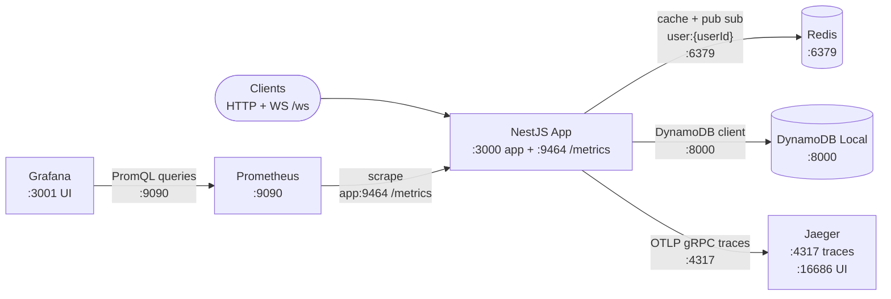

# nestJSBackend

NestJS 12 API with HTTP + WebSocket, backed by Redis and DynamoDB, observed via Jaeger, Prometheus, and Grafana.

## Architecture



| Connection | From | To | Protocol | Notes |
| --- | --- | --- | --- | --- |
| HTTP + WS | Clients | NestJS App | HTTP :3000, WS /ws | JWT RS256 required, WS identity is userId + clientId + token sub |
| Cache + pub/sub | NestJS App | Redis | Redis :6379 | Shared client, `user:{userId}` fan out, `POST /redis` default TTL 3600s |
| Storage | NestJS App | DynamoDB | HTTP :8000 local, `DYNAMODB_ENDPOINT` | DynamoDB Local in compose |
| Traces | NestJS App | Jaeger | OTLP/gRPC to :4317 | `OTEL_EXPORTER_OTLP_ENDPOINT`, service `nestJS-server`, UI on :16686 |
| Metrics | Prometheus | NestJS App | Kubernetes EndpointSlice discovery, one target per ready app pod on :9464 (Compose uses a static `app:9464` target) | Standalone scrape server: HTTP `http_requests_total`, `http_request_duration_seconds`, `http_request_size_bytes`, `http_response_size_bytes`, and `http_in_flight_requests`, plus `@prometheus-io/client` default `nodejs_*` / `process_*` runtime metrics |
| Dashboards | Grafana | Prometheus | PromQL HTTP :9090 | UI on :3001 (container :3000), provisioned Prometheus datasource + Node.js dashboard |

## Running multiple replicas

WebSocket sessions stay local to each replica, while Redis owns short-lived client claims that each session renews, and DynamoDB remains the presence source. The load balancer must support WebSocket upgrades. Every replica needs Redis access for claims and user fan-out. Give pods a termination grace period longer than the shutdown drain so in-flight connections can close with 1001. Prometheus must scrape `/metrics` on port 9464 of every replica.

## Kind lab

Prerequisites: Docker, kind, kubectl, and helm. From the repo root:

```bash
bash kind/bootstrap-kind.sh
```

The script creates the `backend-lab` cluster if needed, selects the `kind-backend-lab` context, installs Envoy Gateway and Argo CD, builds and loads `productionbackend:local`, and applies the Argo CD `Application`. Argo CD then syncs `k8s/` from the `main` branch of `https://github.com/Galen019/nestJSBackend.git` into the `backend-lab` namespace. Local manifest edits are not deployed until they are pushed. Rerunning the script also restarts an existing app deployment, because the image tag does not change and loaded pods keep the old build until they are recreated.

If the cluster already exists but was created without `kind/kind-config.yaml`, the host port mapping will be missing. Recreate it before running the script:

```bash
kind delete cluster --name backend-lab
bash kind/bootstrap-kind.sh
```

Envoy Gateway maps the kind node port `30080` to `127.0.0.1:8080`. Add the route hostnames to `/etc/hosts` (or `C:\Windows\System32\drivers\etc\hosts` on Windows):

```text
127.0.0.1 app.localhost argocd.localhost grafana.localhost prometheus.localhost jaeger.localhost
```

The gateway exposes these URLs:

| Service | URL |
| --- | --- |
| Backend API | `http://app.localhost:8080` |
| Argo CD | `http://argocd.localhost:8080` |
| Grafana | `http://grafana.localhost:8080` |
| Prometheus | `http://prometheus.localhost:8080` |
| Jaeger | `http://jaeger.localhost:8080` |

The bootstrap installs Argo CD with `server.insecure=true`, so its HTTP route works without TLS. Log in as `admin` with the password from:

Bash
```bash
kubectl -n argocd get secret argocd-initial-admin-secret -o jsonpath='{.data.password}' | base64 -d
```

Powershell
```powershell
[System.Text.Encoding]::UTF8.GetString([Convert]::FromBase64String((kubectl -n argocd get secret argocd-initial-admin-secret -o jsonpath='{.data.password}')))
```

Grafana uses `admin` / `admin`. To check the sync and workload state:

```bash
kubectl get application -n argocd
kubectl get pods -n backend-lab
```

See `docker-compose.yml` for the local wiring and `AGENTS.md` for repo conventions.

99% generated from opencode
