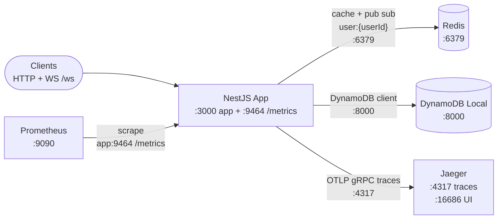

# nestJSBackend

NestJS 12 API with HTTP + WebSocket, backed by Redis and DynamoDB, observed via Jaeger and Prometheus.

## Architecture

| Connection | From | To | Protocol | Notes |
| --- | --- | --- | --- | --- |
| HTTP + WS | Clients | NestJS App | HTTP :3000, WS /ws | JWT RS256 required, WS identity is userId + clientId + token sub |
| Cache + pub/sub | NestJS App | Redis | Redis :6379 | Shared client, `user:{userId}` fan out, `POST /redis` default TTL 3600s |
| Storage | NestJS App | DynamoDB | HTTP :8000 local, `DYNAMODB_ENDPOINT` | DynamoDB Local in compose |
| Traces | NestJS App | Jaeger | OTLP/gRPC to :4317 | `OTEL_EXPORTER_OTLP_ENDPOINT`, service `nestJS-server`, UI on :16686 |
| Metrics | Prometheus | NestJS App | HTTP scrape `app:9464/metrics` | Standalone scrape server, `http_requests_total` + `http_request_duration_seconds` |

See `docker-compose.yml` for the local wiring and `AGENTS.md` for repo conventions.
